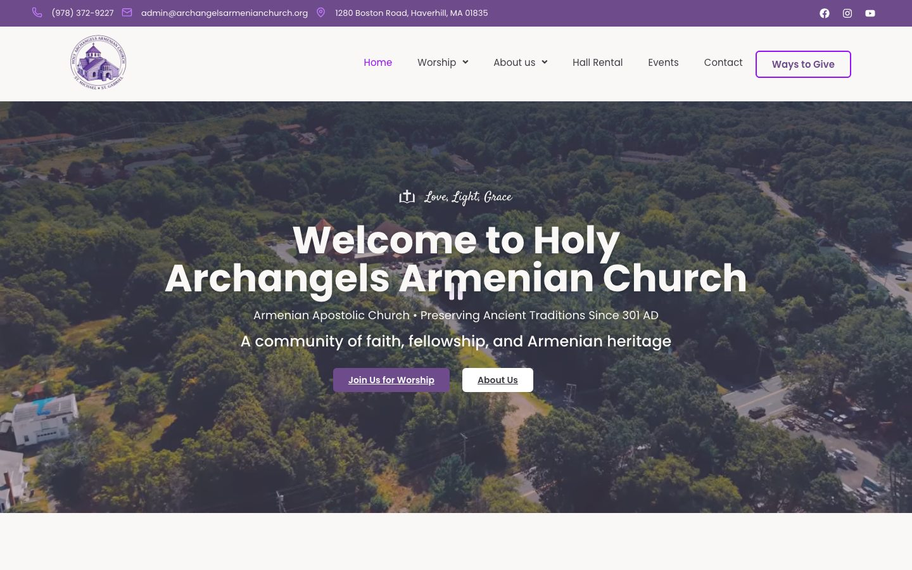
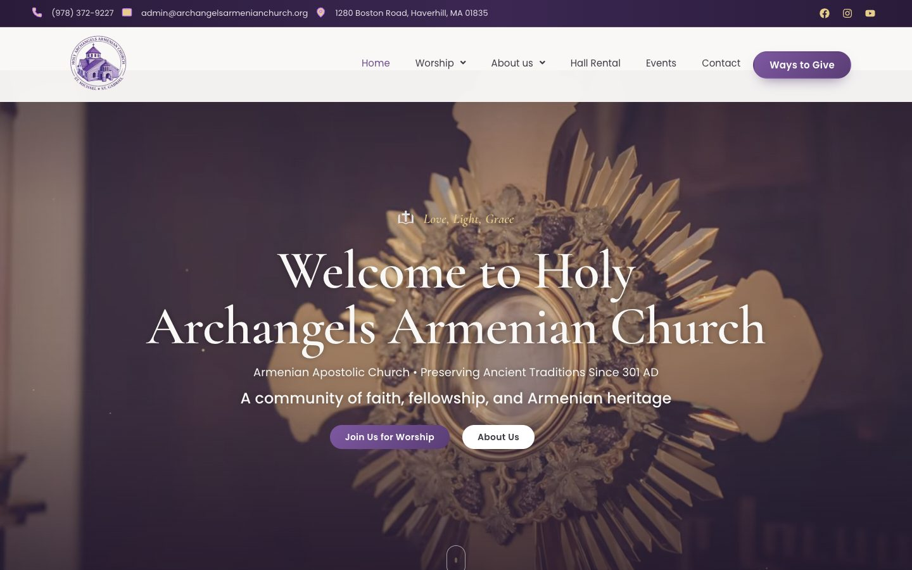

# Holy Archangels Church — premium layer

**▶ Live preview:** https://amirsam-hp021.github.io/holy-archangels-church-premium/
(use the "Premium design ON/OFF" button, bottom-left, to compare with the current site)

Site: https://1136991.us12.myftpupload.com (Elementor Free + Hello Elementor + Header Footer Elementor,
Premium Addons, Modern Events Calendar, Ninja Forms).

Nothing on the pages is rebuilt. Two snippets sit on top of the existing Elementor design and apply
site-wide, including every inner page:

```
church website/
├─ css/church-premium.css   → WPCode "CSS Snippet", Site Wide Header
├─ js/church-premium.js     → WPCode "JavaScript Snippet", Site Wide Header
└─ _build/                  preview harness, screenshots, research (not uploaded)
```

## Install (about 5 minutes)

1. **Plugins → Add New → "WPCode"** (Insert Headers and Footers by WPCode) → Install → Activate.
2. **Code Snippets → + Add Snippet → Add Your Custom Code → CSS Snippet**
   - Title: `Church Premium CSS`
   - Paste the whole of `css/church-premium.css`. The `@import` line must stay first.
   - Insertion: **Auto Insert → Site Wide Header** → toggle **Active** → Save.
3. **Add Snippet → JavaScript Snippet**
   - Title: `Church Premium JS`
   - Paste the whole of `js/church-premium.js`.
   - Insertion: **Auto Insert → Site Wide Header** → **Active** → Save.
4. Clear caches: GoDaddy **Flush Cache** (top admin bar) and **Elementor → Tools → Regenerate CSS & Data**.
5. Open the site in a private window and hard-refresh.

To switch it all off, deactivate the two snippets. Nothing else is changed.

## What it adds

| Area | Effect |
|---|---|
| Header | Top bar scrolls away and the menu stays pinned (frosted glass + shadow once scrolled). Logo eases smaller. |
| Navigation | Logo, menu items and button cascade in on load. A gold line with a small diamond, plus a soft pill, glide to whichever item you hover, then return to the current page. Dropdown arrows flip. Dropdowns unfold with items sliding in one by one and a gold side bar on hover. "Ways to Give" is a gradient pill with a shine and a soft gold pulse. On mobile the burger morphs into an X and menu items cascade in. |
| Hero | Words rise in, one after another, from a blur. Cinematic gradient veil over the video. Drifting gold "candle-light" motes. Scroll cue. Content drifts up as you scroll. Deep purple fallback while the video loads. YouTube title bar cropped out. |
| Typography | Large titles in **Cormorant Garamond** (an elegant serif). Script eyebrows ("Hope in Christ") become gold italic serif. Gold ornament line under section titles. |
| Colour | The neon violet (#9810FA) becomes refined gold / soft brand violet. Card top bars become a purple → gold gradient. |
| Cards | Lift and a deeper shadow on hover. Photos zoom slowly. Icons tilt. Gold round badges on the organisation cards. |
| Buttons | Pill shape, shine sweep, lift, "→" on Learn More / Read More. Underlines removed. |
| Scroll | Every block below the fold fades and rises into view, staggered left → right. Large photos open with a curtain wipe. |
| Sections | Photo-background sections get a soft vignette. Plain photo backgrounds also get parallax. |
| Calendar, form, map | Rounded calendar with gold/purple "today". Form fields with a gold focus ring and gradient submit. Map desaturated until hovered. |
| Footer | Deep plum gradient with a gold hairline. Gold serif headings. Links slide on hover. Social icons turn gold. |
| Extras | Gold scroll-progress bar. Back-to-top button with a progress ring. Gold text selection. Slim scrollbar. |

Built to be safe:
- **Accessibility:** respects "reduce motion" (no animation at all), keyboard focus rings.
- **Fail-safe:** content still shows after 4 s if the script never runs. Never runs inside the Elementor editor.
- **Mobile:** fixes a sideways-scroll bug the theme's mobile menu caused on phones.

## Content issues found on the live site (fix in Elementor — not covered by the snippets)

- Homepage: two sections are both titled **"About Our Church"**, and the events calendar section is titled **"Our Organisations"** (suggest "Upcoming Events").
- Homepage value cards: three of the four say **"Faith — Rooted in the ancient…"**.
- "Chicago area" in the About text and footer, but the church is in **Haverhill, MA**.
- Contact cards (homepage, Contact, Hall Rental, sacrament pages) show **(630) 555-0123, info@hyepointeac.org, 7200 Oakwood Drive, Glendale Heights, IL**. These look like template placeholders; the header shows (978) 372-9227 and admin@archangelsarmenianchurch.org.
- About / Pastor's Corner text mentions **"Hye Pointe"**.
- Organisation card descriptions look swapped (e.g. Men's Club says "Sunday School, VBS, and youth programs…").
- About page "Our Consecration" tab still has **lorem ipsum** bullets.
- Footer: "Women's Guil**l**d", "Men'**'**s Club", "© 2025".
- Browser tab title is "h99.2f2.myftpupload.com Managed WordPress Site". Set it in **Settings → General → Site Title**.

## Preview locally

`_build/preview.mjs` loads the live site in a headless browser and injects both files exactly where WPCode puts them:

```
node ~/.claude/skills/browser-automation/browser.mjs https://1136991.us12.myftpupload.com/ \
  --script "./_build/preview.mjs"        # env: PAGES="/,/about-us/" W=390 TAG=v5 OFF=1 (original)
```
Screenshots go to `_build/shots/`.

## Screenshots

| Before | After |
|---|---|
|  |  |

- Navigation and dropdown: `screenshots/03-navigation-dropdown.jpg`
- Service cards and photo banner: `screenshots/04-sections-after.jpg`
- Organisation cards: `screenshots/05-organisations-after.jpg`
- Mobile: `screenshots/06-mobile-after.jpg`, `screenshots/07-mobile-menu.jpg`

## Hosted preview (GitHub Pages)

`docs/` is a snapshot of eight live pages with the premium layer applied. Images and video load from the live site.
`_build/demo.js` adds the ON/OFF switch and disables the contact form, so test messages never reach the church.
Rebuild after any change with `node _build/build-demo.mjs`, then commit `docs/`.

## Live local preview

Needs Node 18+. From this folder run `node _build/local-server.mjs` and open http://localhost:8080.
It shows the live site with both files applied; add `?off=1` to any page to see the original.
